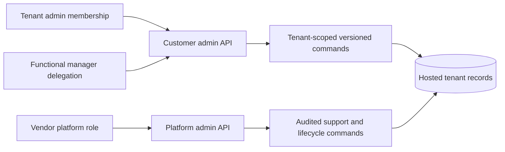

# D5O administration architecture

Baseline `origin/main` `4cf881b5`. Evidence: **C** inspected code/migration, **T** test source, **D** prior documentation. This is a product and permission design, not an implemented UI claim.

## Current boundary

The hosted customer console at `app/work/admin/[[...section]]/page.tsx:35-78` exposes overview, users, workforce, configuration, authority and audit for Rybex only [C]. `app/api/d5o-hosted/admin-configuration/route.ts:12-56` requires Rybex plus an admin actor; `membership-access/route.ts:21-69` permits Rybex/Rotork and forwards a service-role command; `handoff-routes/route.ts:11-29` retires direct editing and points to configuration [C]. Database admin commands recheck active workspace and membership and record reason/replay (`20261019183127_d5o_admin_backend.sql:205-265`) [C]. A distinct vendor platform console and delegated support grants are not established in the inspected app. The older `app/admin/page.tsx` is a readiness/demo surface, not a vendor control plane [C].

## Separate products

| Product | Navigation and pages | Authority contract |
|---|---|---|
| **D5O Platform Administration** | Tenant directory → provision/status/health → plans/entitlements → rollout/kill switch → template releases → integrations/operations → support case → security/audit. | Separate vendor identity/role; tenant context explicitly selected and time limited for support. Every mutation uses a bounded command with reason, ticket/reference, actor, tenant, before/after and receipt. No raw SQL, service key or unrestricted table editor. |
| **Customer Administration** | Organization → people/invitations/roles → teams/units → work types → approvals/decision rights → phase and handoff routes → evidence/checklists → resources/qualifications → notifications/integrations → draft review/publication/history. | Active membership in selected tenant; permission-aware actions; draft and publication rights separated where policy requires. Database command rechecks tenant, role, resource, expected version and invariant bounds. |

## Permission map

| Operation | Platform admin | Tenant admin | Functional manager | Ordinary user |
|---|---|---|---|---|
| Provision/suspend tenant; plans; rollout | Yes, bounded vendor command | No | No | No |
| Invite/revoke tenant user; assign approved role | Scoped support only | Yes | Delegated team only | No |
| View tenant health/audit | Aggregated; scoped support for details | Own tenant | Own function when granted | Own actions only |
| Draft operating policy | Template defaults | Own tenant | Delegated family | No |
| Validate/publish/activate policy | Template release only | Own tenant with separation as configured | Review, never self-elevate | No |
| Business approval | Only if separately assigned tenant role under support procedure | Per assigned decision right | Per assigned right | Per assigned right |
| Personal notification preferences | Own account | Own account | Own account | Own account |

Do not infer authorization from hidden buttons. Each API/RPC must recheck active membership or vendor support grant at execution time. Admin role is currently a single hosted role (`20261019213000_d5o_hosted_configuration_management.sql:123-130`) [C]; custom roles need a bounded permission catalog, explicit approval and migration path. Vendor admins should not automatically hold customer decision rights.

## UX standards and implementation

Use a consistent workspace switcher showing verified tenant and role, sidebar sections matching the two product maps, searchable/paginated tables, page header with scope and status, and forms with inline constraints. Configuration pages show active version, draft revision, diff, impact on new and in-flight work, validation errors, change reason and named publisher. Destructive or broad actions show affected tenant and item count and require explicit confirmation. Audit history is adjacent to the action it explains. Buttons are permission-aware, and denied server responses remain clear without disclosing another tenant's existence.

First reuse the existing admin shell and hosted RPC (`app/work/admin/[[...section]]/page.tsx`, `20261019213000_d5o_hosted_configuration_management.sql`) [C]. Replace literal `rybex` route selection with workspace identity from the authenticated actor and tenant registry only after P0 cross-tenant tests. Keep verified-target and invitation-recipient pilot gates until a tested onboarding workflow handles them. Build the platform console as a narrow separate route/permission boundary when tenant lifecycle operations are ready; avoid a visual redesign before command and permission boundaries are sound.

Acceptance: a tenant B admin can perform only B draft/validate/publish/activate and membership operations; an A admin receives denial for B objects; a vendor support actor without an approved scoped grant receives denial; all successful mutations contain actor, tenant, reason, version and request receipt. Test source `scripts/qa-configuration-admin-api.mjs` [T source] is insufficient by itself because current hosted UI/API is Rybex-only.
