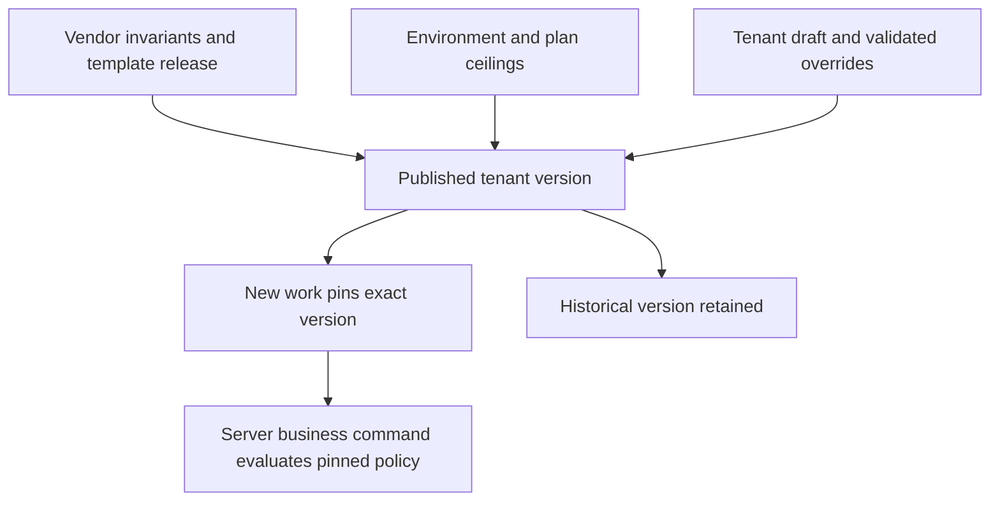

# D5O configuration architecture and consolidation

Baseline `origin/main` `4cf881b5`. **C** means inspected code/migration; **T** means test source or execution; **D** means prior documentation. No production configuration was read.

## Authority decision

There is **more than one implemented configuration path**. The older `config_*` foundation in `supabase/migrations/0017_configuration_foundation_core.sql`–`0026_configuration_template_pack_seed_data.sql`, read by `lib/d5o/configuration/server.ts:13-34` and edited through `app/work/configuration-actions.ts:48-101`, has versioning and tests [C,T source]. Hosted operations use `d5o_hosted.configuration_versions` and the bounded admin command in `supabase/migrations/20261019213000_d5o_hosted_configuration_management.sql:1-377` via `app/api/d5o-hosted/admin-configuration/route.ts:12-56` [C]. Prototype pricing has a separate draft/publish/activate path in `lib/d5o/prototype-work/pricing-policy-command.ts:5-34`, used by `commercial-command.ts:73-138` [C]. Treat the **hosted tenant version** as the future runtime authority for commercial work because it owns hosted work pins, transactional publication and audit. Retain old tables and versions for compatibility and migration until equivalence is proven; freeze new policy expansion in alternate stores.

## Deterministic resolution

At request time, resolve verified workspace and membership first. For new work, select one active published tenant version associated with that workspace; reject zero or multiple active matches. Combine immutable vendor constraints, environment safety controls, plan entitlement ceilings, vendor template defaults, then validated tenant overrides in that precedence order. A lower level may narrow but may not raise security or financial maxima defined above it. Store the resolved policy schema version and exact configuration-version ID on the work record and decision event. Existing work keeps its pinned version unless an explicit, audited migration command checks compatibility and obtains required approval. Rollback activates an earlier valid version for **new** work; it does not rewrite decisions or silently repin open work.

`components/d5o/platform/published-phase-configuration.ts:14-99` validates the six fixed phases and resolves pinned published/superseded contracts [C]. Its legacy unpinned fallback is a compatibility path, not a commercial default. `20261019213000_d5o_hosted_configuration_management.sql:123-153,296-377` already supplies admin membership checks, expected active version, edit revision, transactional validate/activate, receipt and event history [C]. Add schema migration for policy evolution, effective date overlap checks, hash/semantic diff display, and a controlled rollback action using this lifecycle. Never mutate a published version.

## Two-tenant threshold gap

The hosted `save-policy` key whitelist in `20261019213000_d5o_hosted_configuration_management.sql:179-223` supports phase labels/purpose, selected Design/Deploy/Operate controls, and timezone; it does **not** define a service-work approval threshold. `components/d5o/platform/develop-pricing.ts:5-6` and `lib/d5o/prototype-work/pricing-policy-command.ts:5-34` form another policy path, but do not implement the requested per-tenant $10,000/$25,000 service approval policy. The existing editor is Rybex-only (`app/api/d5o-hosted/admin-configuration/route.ts:13`; `app/work/admin/[[...section]]/page.tsx:35-36`) [C]. Thus the central acceptance scenario cannot pass without changes. Minimum addition: bounded `serviceWorkApprovalThresholdMinor` with currency, permitted range and rule semantics in the hosted manifest, validator and admin command; server-side approval decision command reads the pinned hosted version, records amount, result, actor, tenant and version atomically. Do not let tenant settings bypass segregation of duties or mandatory evidence.

## Who may change what

| Principal | Allowed changes | Fixed bounds |
|---|---|---|
| D5O platform admin | Tenant lifecycle, template and schema releases, plan ceilings, emergency flags, support grants. | Audited vendor API; no unrestricted customer data editing. |
| Tenant admin | Organization branding, users/approved roles, work types, bounded monetary policy, handoff roles, evidence/checklists, integration preferences; draft/validate/publish/activate. | Cannot change vendor invariants, audit, RLS, schema internals or another tenant. |
| Functional manager | Propose scoped phase/work-type rules or route changes where delegated; approve within separate decision right. | Cannot self-publish an elevated authority policy; no security/plan changes. |
| Ordinary user | Personal notification preferences and assigned work actions. | No tenant policy publication or role grants. |

## Six-phase policy coverage

| Phase | Existing configurable behavior and hardcoded boundary [C] | Next bounded capability; fixed invariant | Effect on work |
|---|---|---|---|
| Discover | `components/d5o/platform/DiscoverCRMWorkspace.tsx:120-129` reads Discover policy; `app/work/configuration-actions.ts:58-74` saves legacy manifest. Rybex/Rotork work type union in `work-types.ts:1`. | Move qualification criteria, required fields, owner/approval routing to hosted version. Identity, tenant, record ID fixed. | New records use new active version; old decisions keep pin. |
| Define | `lib/d5o/prototype-work/define-command.ts:36-37` requires pinned contract; phase form validates fields. | Add scope, risk class and bounded commercial threshold, typed approval right. Keep command idempotency and evidence identity fixed. | Re-evaluation only by explicit revision/migration. |
| Design | `lib/d5o/prototype-work/design-command.ts:174-186` uses release policy; hosted admin edits limited Design controls. | Work package, acceptance/evidence policy. Keep package linkage and accepted source integrity fixed. | Existing packages retain policy version. |
| Develop | `lib/d5o/prototype-work/commercial-command.ts:73-138` reads separate pricing policy; resource policy is not unified. | Connect pricing, qualification, capacity and authorization to hosted command policy. Keep money arithmetic, actor identity and segregation fixed. | Price/release events cite pinned version. |
| Deploy | `lib/d5o/prototype-work/deploy-command.ts:87,136` enforces hours/evidence controls. | Extend checklist, inspection, photo, signature and customer acceptance requirements through bounded schema. Keep evidence ownership and immutable acceptance fixed. | In-flight jobs stay pinned; exceptional upgrades explicit. |
| Operate | `lib/d5o/prototype-work/operate-command.ts:39-57,76,99-103,184,281` uses SLA/coverage/handoff controls. | Add closeout, receivables and follow-up rules. Keep invoice math, audit and settled financial history fixed. | Historical invoices/decisions never recomputed silently. |

Reuse one shared policy evaluator for typed amount comparison, required evidence, roles, deadlines and route resolution, called from server commands. Avoid a universal custom-object engine. `docs/architecture/d5o-phase-configuration-prototype.md` [D] describes prototype-local later phases and explicitly cautions that local snapshots are not authoritative gate commands.

## Consolidation sequence

1. Inventory every consumer of `config_*`, hosted versions and prototype pricing; document work pins and historical records.
2. Add equivalence tests for current Rybex and Rotork behavior, including negative tenancy and stale revisions.
3. Extend hosted schema/validator with the one service threshold policy and migration version; retain existing rows.
4. Route one hosted service decision command through the pinned version; record immutable decision event.
5. Make tenant-neutral admin draft/validate/publish/activate available only after the tenant gate passes.
6. Migrate remaining phase policies one bounded setting family at a time; mark legacy writers read-only after parity. Keep old version readers for historical work.

Existing test sources `scripts/qa-configuration-publication.mjs`, `scripts/qa-configuration-admin-api.mjs`, `scripts/qa-published-phase-contract.mjs` and `scripts/qa-phase-contract-activation.mjs` [T source] cover parts of the older/prototype paths. They do not directly prove the hosted admin command for arbitrary tenants.
