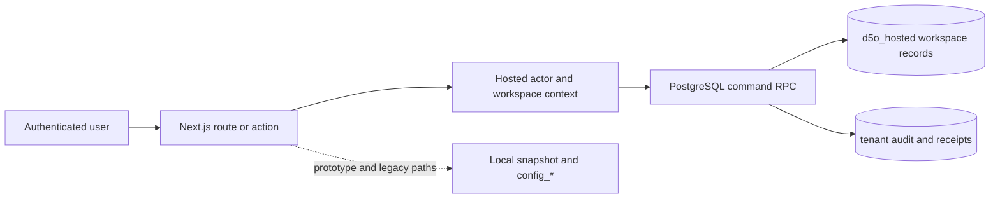

# D5O enterprise SaaS architecture assessment

Assessment baseline: `origin/main` at `4cf881b506def45564040d767292c5c8c4ecbe48` (2026-10-23). Evidence labels: **C** code or migration inspection, **T** automated test source or execution, **R** runtime observation, **D** prior documentation. A migration in Git is not proof it is applied in production. The original task checkout was `feature/billing-v2-guided-ui-replacement` at `ef5cfe85fd7dc516db1bf0510b42147d47b0b1c6` with extensive pre-existing changes; this assessment uses a clean separate worktree of `origin/main` because the named hosted paths are absent on that feature branch.

## Executive verdict

**NO** for onboarding an arbitrary second independent commercial customer today. The hosted database has a credible tenant foundation, but the product is bounded to named Rybex/Rotork pilots, the customer administrator route is Rybex-only, and the requested independent service-work monetary policy is not in the hosted configuration command. No adversarial two-tenant production test or production migration inventory was available. On 2026-10-23, read-only production `/api/health` returned HTTP 200 with `alive`, while `/api/readiness` returned HTTP 503 with `billing_persistence`, `field_issue_persistence`, `closeout_persistence`, and `scanner_mode` issue codes [R]. These probes do not establish the deployed commit or tenant isolation. See [tenant security](D5O_TENANT_SECURITY_ASSESSMENT.md) and [acceptance plan](D5O_TWO_TENANT_ACCEPTANCE_PLAN.md).

## Architecture observed

Next.js App Router routes and server actions are in `app/`; Supabase SSR auth, PostgreSQL migrations, RPCs and storage form the hosted backend (`proxy.ts`, `lib/d5o/auth/supabase-server.ts`, `supabase/migrations/`) [C]. `lib/d5o/hosted/prototype-context.ts` and `supabase/migrations/20261007013134_d5o_hosted_workspace_authority.sql` resolve a user and active workspace membership [C]. Hosted commands run through public RPCs with explicit actor checks, while prototype/local and older `config_*` paths coexist [C]. `lib/d5o/auth/hosted-target.ts` is an intentional verified-target restriction; `lib/d5o/auth/approved-test-recipient.ts` is an intentional invitation pilot control [C]. Retain these until a tested generalized control replaces them.

## Capability matrix

Classification describes the **commercial multi-tenant requirement**, not whether any code exists. Complexity is relative engineering effort. “Test source” means a test exists, not that it passed in this assessment.

| Area | Classification; evidence and demonstrated limit | Deficiency, risk, remediation | Priority / complexity |
|---|---|---|---|
| Multi-tenancy | **PARTIAL**. Hosted workspace/membership and actor RPC: `20261007013134_d5o_hosted_workspace_authority.sql:3-105`, `lib/d5o/hosted/prototype-context.ts:25-79` [C]. No live adversarial proof. | Named-workspace allowlists prevent arbitrary customer onboarding. Inventory every command/read/storage path and run two-tenant isolation matrix. | P0 / L |
| Authentication | **PARTIAL**. Supabase SSR user validation: `proxy.ts`, `lib/d5o/auth/supabase-server.ts`; hosted actor RPC [C]. | MFA policy, SSO/SCIM provisioning and revocation SLA unqualified; add enterprise identity only when contracted, test revoked sessions now. | P0 then P2 / M–L |
| Authorization | **PARTIAL**. Active membership and admin checks in `20261019213000_d5o_hosted_configuration_management.sql:123-130` [C]. | Mixed hosted, legacy, prototype permissions and hardcoded role lists; require resource-level negative tests and one entitlement map. | P0 / L |
| Business APIs | **PARTIAL**. Hosted command RPC and idempotent admin receipts in `20261019213000_d5o_hosted_configuration_management.sql:101-153` [C]. Legacy `lib/d5o/opportunities/supabase-repository.ts:421-473` directly updates via service role after a separate scoped read [C]. | Prototype/local and privileged direct writes coexist; test reachability, consolidate reachable mutations into atomic tenant-scoped commands. | P0–P1 / L |
| Configuration | **PARTIAL**. Hosted draft/revision/validate/activate and audit: `20261019213000_d5o_hosted_configuration_management.sql:101-377`; older `0017_configuration_foundation_core.sql`–`0026_configuration_template_pack_seed_data.sql` [C]. | Competing lifecycle/price paths; no hosted service approval amount policy. Consolidate on hosted version/pin without deleting history. | P1 / L |
| Administration | **PARTIAL**. Rybex customer console: `app/work/admin/[[...section]]/page.tsx:35-78`; hosted admin API `app/api/d5o-hosted/admin-configuration/route.ts:12-56` [C]. | No tenant-neutral self-service or separate vendor operations product. | P1 / L |
| Workflows | **PARTIAL**. Six-phase form contract and pinned evaluator: `components/d5o/platform/published-phase-configuration.ts:14-99`; phase work routes `app/work/[workspace]/[work]/page.tsx` [C]. | Local prototype state and hosted authority are not uniformly coupled; qualify each phase's server command. | P1 / XL |
| Feature management | **MISSING** for tenant plans/entitlements. Hosted target pilot gate `lib/d5o/auth/hosted-target.ts:3-30` [C] is a deployment safety control. | Add small vendor-owned feature/plan registry only after tenant security; preserve emergency disable. | P2 / M |
| Integrations | **PARTIAL**. Resend/Twilio/Web Push in `lib/d5o/scheduling/notification-providers.ts:9-39`; Graybar adapter in `lib/d5o/graybar/supplier-adapter.ts:9-16` [C]. | Tenant credential ownership, OAuth, webhook replay/isolation not established. | P2 / L |
| Auditability | **PARTIAL**. Config event actor, membership, reason, before/after: `20261019213000_d5o_hosted_configuration_management.sql:14-26,365-371` [C]. | Prove complete mutation coverage, retention and export isolation. | P0–P2 / M |
| Storage | **IMPLEMENTED BUT UNVERIFIED**. Evidence/hosted schema and private index: `app/api/d5o-hosted/private-evidence-index/route.ts`, `20261007013134_d5o_hosted_workspace_authority.sql` [C]. | Test path spoofing, signed URLs, cross-tenant object reads, retention. | P0 / M |
| Background jobs | **PARTIAL**. Notification settings use process-local JSON in `lib/d5o/scheduling/notification-settings.ts:8-79` [C]. | Multi-instance persistence and tenant-scoped retry/failure isolation unproven; move durable preferences to tenant-scoped store. | P2 / M |
| Operations | **PARTIAL**. Health/readiness APIs: `app/api/health/route.ts`, `app/api/readiness/route.ts`; health returned 200 [C,R]. | Health is liveness, not end-to-end tenant readiness; no repository CI or `vercel.json` seen, external controls unknown. | P0–P2 / M |
| Commercial scale | **MISSING** for plans, usage metering and self-service commercial onboarding in inspected app/migrations [C]. | Establish tenant lifecycle and support boundaries before sales scale; defer billing provider until needed. | P2 / L |
| User experience | **PARTIAL**. Admin and phase navigation exist; `app/work/admin/[[...section]]/page.tsx`, `app/work/[workspace]/[work]/page.tsx` [C]. | Permission-aware tenant-neutral admin journeys, errors and audit visibility need acceptance testing. | P1 / M |

## Ten most consequential gaps

Ordered by combined security and commercial impact; effort and dependency are detailed in the roadmap.

1. No executed cross-tenant adversarial qualification over DB, API, evidence and revocation (P0).
2. Rybex/Rotork allowlists across routes and `WorkspaceKey` prevent independent onboarding (P0/P1).
3. Hosted monetary approval threshold is absent, so the $15,000 proof cannot pass (P1).
4. Hosted and `config_*` version models plus prototype pricing create conflicting authority (P1).
5. Browser-local phase and pricing outcomes remain distinct from authoritative commands (P1).
6. Vendor and tenant administrator authority and interfaces are not separate (P1).
7. Evidence, privileged RPC/direct mutation, and storage isolation lack complete negative runtime coverage (P0).
8. Tenant provisioning, migration inventory and recovery are not demonstrated at commercial scale (P0/P2).
9. Durable per-tenant notification preferences, retry and integration credential handling are incomplete (P2).
10. Enterprise identity, plans, metering and support controls remain unimplemented or unverified (P2).

## Preservation and scope

Preserve the hosted schema/RPC tenant checks, version pins, receipt/audit design, six-phase lifecycle, Rybex reference templates and verified-target/test-recipient pilot controls. Do not interpret legacy demo or unpinned prototype behavior as production authority. Prior direction in `docs/architecture/d5o-phase-configuration-prototype.md` is [D] and explicitly calls later phase snapshots prototype-local; conclusions above rest on [C] unless marked [R].

## Verification performed and limits

`node scripts/verify-configuration-foundation-rls-static.mjs` passed in this assessment worktree [T execution]. `node scripts/qa-configuration-inventory.mjs` and `node scripts/qa-published-phase-contract.mjs` could not start because the clean worktree has no installed `typescript` package; these are **not** pass results [T attempted]. `git diff --check` was clean. No database test, migration application, authenticated browser journey, production data query, deployment or CI job was run. The production probe establishes only the two endpoint responses above; repository-to-deployment SHA, actual migration state, live RLS grants, storage policies, backups, SSO settings and external Vercel controls remain unverified.
